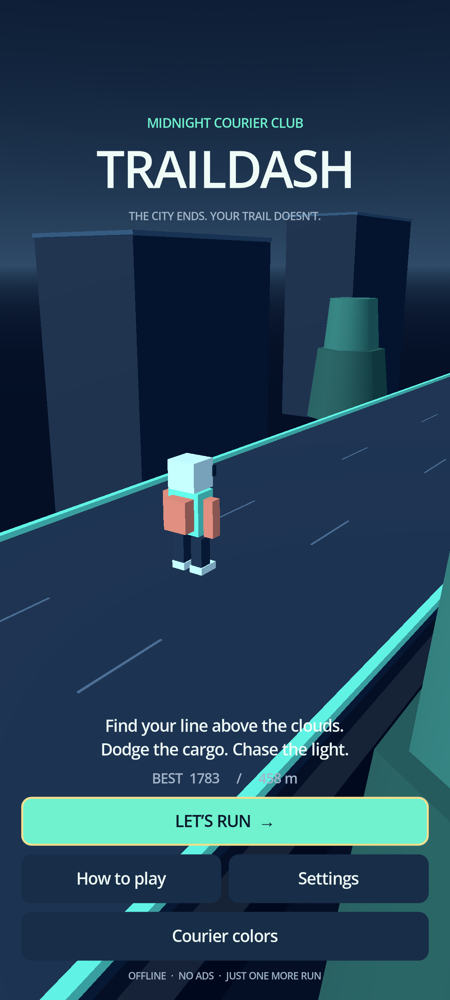

# TrailDash

**Find your line above the clouds.** An original, offline 3D Android runner through a midnight
skybridge garden. Guide a tiny courier between cargo, mint gates and tall garden pylons, collecting
amber light tokens as the trail gets faster.



## Play the local Android build

The local debug package is `builds/traildash-0.1.0-debug.apk`, with its SHA-256 file alongside it.
Generate these files using the Android build instructions below; APKs are not stored in this repository.

This is a playable **development MVP**, installed and exercised in a local Android 15 emulator.
It is not a store release. Android 7.0 / API 24 or newer is required; the APK contains ARM64 and
x86_64 libraries. A production signing identity and physical-device release testing remain outstanding.
Builds are generated locally and ignored by Git; the source includes everything needed to recreate one.

```powershell
adb devices -l
adb -s YOUR_DEVICE_SERIAL install -r .\builds\traildash-0.1.0-debug.apk
adb -s YOUR_DEVICE_SERIAL shell am start -n com.portfolio.traildash/com.godot.game.GodotAppLauncher
```

Installing a same-key update preserves progress. Uninstalling removes local progress. A debug build
cannot update an app signed with a different certificate without uninstalling the previous app.

## Controls and features

| Action | Phone | Keyboard |
| --- | --- | --- |
| Change lane | Swipe left/right or arrow buttons | Left/right arrows, A/D |
| Jump coral cargo | Swipe up or Jump | Up arrow, W, Space |
| Slide under mint gates | Swipe down or Slide | Down arrow, S |
| Pause / resume | Pause button or Android Back | P / Esc |

Go around tall garden pylons. One route is always open; consecutive safe lanes are adjacent. Collect
consecutive tokens to build a score multiplier up to 4×. The runner accelerates from 12 to 26 m/s,
and five difficulty bands increase obstacle density. Miss a token and the streak resets.

- Tutorial, countdown, pause, results, fresh restart and personal records.
- Light tokens earned in completed runs unlock coral and lilac courier colors, 60 tokens each.
- Distance badges at 500, 1,500 and 3,000 meters.
- Sound, haptics, reduced effects, optional touch buttons and a 30 FPS battery setting.
- Custom keyboard bindings in Settings; arrows, Space, P and Escape stay reserved.
- Fixed track and obstacle pools, seeded generation, original procedural meshes and synthesized audio.

Focus loss and backgrounding pause the run/countdown. Resume is explicit. Completed results and
settings persist locally; an unfinished run is not resumed after process death. The app makes no
network requests, uses no account/ads/analytics, and requests only optional vibration permission.
English is currently the only authored locale. Touch controls have accessibility names and keyboard
focus styles; screen-reader usability and full accessibility conformance need device validation.

## Run and verify the editable project

```powershell
git clone https://github.com/gopichandchikoti/TrailDash.git
cd TrailDash
```

Use **Godot 4.7.2 stable**, with matching export templates, and Python 3.13 for the development tools.
There are no Godot add-ons or runtime dependencies beyond the engine. Set the executable location for
your installation; personal paths and signing material are not stored in this project.

```powershell
$env:GODOT_BIN = 'C:\path\to\Godot_v4.7.2-stable_win64_console.exe'
& $env:GODOT_BIN --editor --path .
```

Open `project.godot` and press F5, or run `& $env:GODOT_BIN --path .` for desktop testing.

```powershell
python -m venv .venv
.\.venv\Scripts\python.exe -m pip install -r requirements-dev.txt
.\.venv\Scripts\python.exe tools/verify.py --lint-bin .venv\Scripts
```

Verification validates the single content model and fallback, checks formatting/lint, imports the
project, then executes domain, recovery and scene integration tests. Engine errors fail verification
even if Godot returns exit code zero. Test save files are isolated from the player's progress.
`builds/*.log` contains the execution logs. The suite includes 10,000 seeded rows, a three-minute
simulation using the actual world and player code, and Viewport-dispatched touch cancellation/HUD
ownership and menu reset checks. The current suite passes 30,174 assertions. Assertion counts are not coverage percentages.

Authored UI content lives in `public/traildash.model.json`. After editing it:

```powershell
python tools/content.py
.\.venv\Scripts\gdformat.exe --line-length 120 scripts tests
```

The fallback is generated from the same model; invalid schema, unknown locale, missing keys and
placeholder mismatch recover to valid bundled content. No web server or `.env` file is used.

## Build Android

Install matching Godot templates and configure the engine's Android SDK and Java SDK paths.
Use JDK 17 and an Android SDK containing platform-tools, current build-tools and Android platform 36.
This project uses the prebuilt Godot template and does not require Gradle or third-party SDK plugins.
See the [official Godot export instructions](https://docs.godotengine.org/en/stable/tutorials/export/exporting_for_android.html).

```powershell
$env:ANDROID_HOME = 'C:\path\to\android-sdk'
$env:JAVA_HOME = 'C:\path\to\jdk-17'
.\tools\build-android.ps1
# Optionally install and launch on a specific connected emulator or phone:
.\tools\build-android.ps1 -Device YOUR_DEVICE_SERIAL
```

The build script exports, verifies Godot's exit/log status, writes a SHA-256 file, and optionally
installs/launches the APK. Its version comes from `project.godot`; verification checks export-preset
agreement. Godot owns the local debug keystore. Production keys remain owner controlled and are not
created or requested by this project. CI source checks are defined in `.github/workflows/verify.yml`;
the hosted workflow has not been run from this workspace.

## Troubleshooting and demonstration

- Emulator black screen with `GL_MAX_FRAGMENT_UNIFORM_VECTORS`: use `-gpu host` rather than the
  affected SwiftShader GLES implementation. This was reproduced locally; the host GPU rendered correctly.
- A one-time shader cache recompile after changing GPU drivers is expected. Repeated shader failures
  require checking Android logs and the renderer.
- If `adb` briefly disconnects after a headless Godot editor/export run, wait for the selected device
  to reconnect. The build script bounds this wait to 30 seconds.
- Back should pause during play. Returning from Home or another app should show Pause; tap Resume.
- If saving fails, a visible warning appears. A validated backup can be restored explicitly while
  preserving the rejected primary file. No malformed or future-version save is silently overwritten.

Demo checklist: launch → tutorial → countdown → swipe lanes → jump/slide → pause with Back → settings
→ resume → collide → results → retry → main menu → force-stop/relaunch and confirm saved records.
Use a real phone to validate touch latency, notches, audio/haptics, thermals and battery before release.

See [architecture, acceptance and dated verification](docs/architecture.md),
[the engine ADR](docs/adr/001-godot4-mobile-runner.md) and [asset notices](ASSET_LICENSES.md).
The owner has not selected a public source license.
