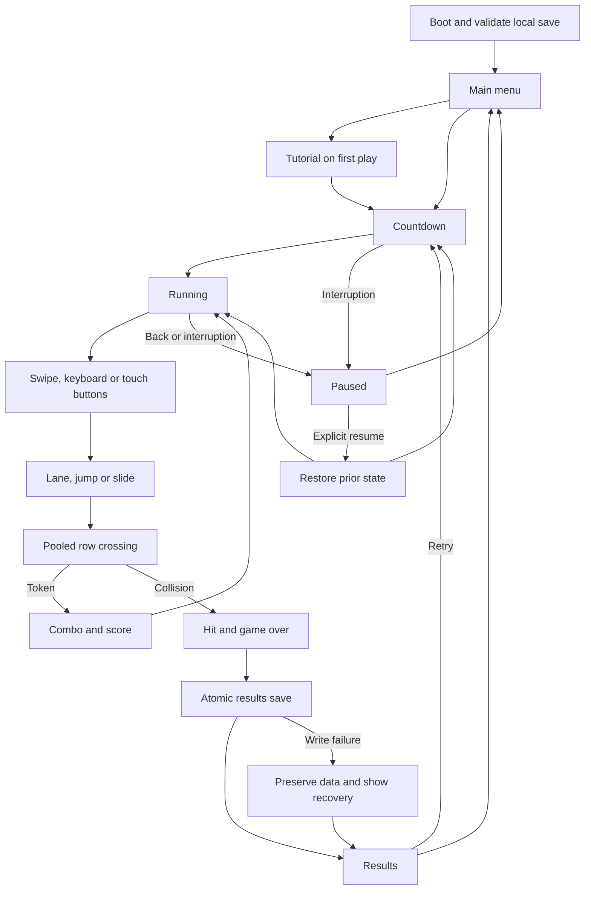

# TrailDash architecture

## Scope and acceptance

TrailDash is an offline Android portrait runner for short, repeatable sessions. The supplied
2026-11-06 scaffold had three disconnected scripts and referenced a missing main scene. Initial
validation preceded Git initialization; the editable project is now versioned on the `main` branch.

Implementation plan: build the deterministic run model and save boundary; connect a pooled original
3D world, swipe/keyboard/button input and accessible menus; test state, fairness, score and recovery;
export a debug APK, install it in a local emulator, and inspect real interactions and Android logs.

Acceptance: three lanes, smooth movement, jump/slide, three obstacle silhouettes, collectible combos,
increasing speed, a permanently reachable route, tutorial/countdown/pause/results/restart, persisted
records/settings/cosmetics, original audiovisual assets, and an installable Android APK.

Falsifiable hypothesis: at maximum speed, adjacent safe lanes remain reachable between every pair
of generated rows. An executable seeded fairness test checks thousands of rows against the actual
lane transition duration and row spacing, followed by a simulated three-minute run.

## Design discovery (checked 2026-11-06)

| Reference | Applicable pattern and tradeoff | Reuse |
| --- | --- | --- |
| [Godot GUI skinning](https://docs.godotengine.org/en/stable/tutorials/ui/gui_skinning.html) | Shared theme, visible focus, consistent touch targets; native controls keep keyboard navigation. | Documentation reference only; no copied artwork. Godot docs CC BY 3.0. |
| [Godot multiple resolutions](https://docs.godotengine.org/en/stable/tutorials/rendering/multiple_resolutions.html) | Anchored portrait HUD and canvas-items expansion; 3D renders independently of UI. | Reference only; no copied assets. |
| [Android adaptive layouts](https://developer.android.com/design/ui/mobile/guides/layout-and-content/adapt-layout) | Bounded menu widths and display insets; phone portrait is required by the product spec. Tablet/foldable adaptation needs separate validation. | Reference only; Android documentation CC BY 4.0. |
| [Godot Android export](https://docs.godotengine.org/en/stable/tutorials/export/exporting_for_android.html) | Installed matching engine/templates, JDK 17, SDK, prebuilt APK export. | Toolchain reference only. |

Two directions considered: warm forest glider (organic canopy, wood obstacles) and midnight skybridge
courier (architectural silhouettes, luminous route markings). The latter is chosen for clear geometry
and inexpensive mobile rendering: ink navy, mint route lights, coral cargo, amber collectible rings,
a tiny helmeted courier and floating garden pylons. All meshes and sound effects are generated locally.
No external models, fonts, music, networking, ads, accounts or analytics are required.

## Boundaries and ownership

| Capability | Acceptance | Owner/path | Status | Evidence | Risk |
| --- | --- | --- | --- | --- | --- |
| Run rules | Legal states, speed cap and exact score | `scripts/RunModel.gd` | Verified | Exhaustive state pairs and score checks | No measured branch coverage |
| Fair generation | Adjacent open lane at every row | `scripts/SpawnRules.gd` | Verified | 10,000 seeded rows | Human difficulty study outstanding |
| Saves | Validated, versioned, recoverable local progress | `scripts/SaveRepository.gd` | Verified | Roundtrip/malformed/backup/migration tests; Android relaunch | No cloud recovery |
| Content | Valid model and usable fallback | `scripts/Content.gd`, `public/traildash.model.json` | Verified | Schema/key/placeholder checks; packaged JSON inspected | English only |
| Character | Lanes, jump, slide and original avatar | `scripts/PlayerController.gd` | Verified | Simulation and Android gestures/buttons; outer-lane jump capture | Physical touch latency unmeasured |
| World pool | Bounded nodes, fair repeatable run | `scripts/TrackSpawner.gd`, `scripts/WorldArt.gd` | Verified | Three-minute simulation, unchanged pool | Hardware thermal performance unmeasured |
| Lifecycle | Pause on Back/background; explicit resume | `scripts/GameManager.gd` | Verified on emulator | Scene checks and Android interruption/relaunch | Process death ends unfinished run |
| Menus/settings | Working controls, records and results | `scripts/GameUI.gd`, `scripts/UIFactory.gd` | Verified on emulator | Captures and interactions | Screen reader certification unverified |
| Input | Swipe threshold/debounce, remappable keys | `scripts/SwipeInput.gd`, `scripts/KeyboardControls.gd` | Verified | Gesture and ownership tests; Android swipe and rebind | Multi-device input checks outstanding |

Flow: input -> GameManager -> RunModel / PlayerController -> TrackSpawner crossing events ->
score or HIT -> GAME_OVER -> RESULTS -> atomic SaveRepository -> menu/retry. Focus loss or Android
Back pauses a run; returning requires explicit resume. The physics tree is never globally paused;
only RUNNING advances simulation. Countdown also freezes on interruption.

## Persistence and privacy

Versioned local JSON stores best score/distance, lifetime tokens, unlocked courier colors and settings.
Writes use a temporary file, retain the previous valid backup, then rename. Invalid/unsupported data
is reported and preserved; validated backup is used when possible. No personal data or egress.
Uninstall removes progress; same-key APK updates preserve it. Debug signing is for local validation.

## Verification and remaining release gates

Follow-up plan (2026-11-06): preserve the existing game and player saves; reproduce canceled touches
and swipes released over HUD buttons through Godot's actual Viewport input dispatch; fix touch ownership;
rerun source/domain/scene checks; rebuild, update and launch the APK in the existing TrailDash emulator.
Acceptance: a canceled touch never moves the courier, every owned release clears the gesture, and normal
HUD taps and subsequent swipes still work. Hypothesis: handling an owned release before GUI dispatch,
while starting gestures only from unhandled gameplay presses, prevents stale gesture ownership.
`tests/TouchChecks.gd` is the focused executable check. Physical-device release gates remain separate.

The five districts increase obstacle probability from 55% to 100% in non-safe lanes; speed increases
independently and caps at 26 m/s. Rows are 19 m apart. Adjacent lane transitions take 0.18 seconds,
leaving more than 0.35 seconds of reaction margin even at maximum speed. Jump peaks above the 1.05 m
cargo threshold; a slide lasts 0.9 seconds. Collision is evaluated when a row crosses the player's
plane, including large frame steps, so visual movement cannot tunnel through an entire row.

Physical Android hardware, sustained
thermal/battery performance, multiple refresh rates/notches, screen reader behavior, production signing
and store publication require separate evidence. Code coverage instrumentation is not configured;
passing assertion counts must not be represented as coverage percentages. Hosted source verification
passed after publication, as recorded in the source repository evidence below.

## Execution evidence — 2026-11-06

Environment: Windows PowerShell, Godot `4.7.2.stable.official.ed1daf0bf`, matching Android templates,
Python 3.13, gdtoolkit 4.5.0, JDK 17 and Android build-tools 36.0.0. No Git metadata was present.
Tests use generated local data, not an existing player's files.

| Check | Command / method | Result |
| --- | --- | --- |
| Content and static gates | `python tools/verify.py --godot <Godot executable> --lint-bin <gdtoolkit directory>` | Passed: 73 content keys, generated fallback, gdformat, gdlint, headless import and tests |
| Behavioral suite | `godot --headless --path . --script tests/test_runner.gd` | 30,174 assertions; zero failures; no engine errors or leaked objects |
| Fairness | Twenty seeds × 500 rows, all five bands | Deterministic, safe lane open, adjacent transitions |
| Three-minute simulation | 10,800 steps through actual player/world code | 3,375 m, 176 token crossings, zero collisions, fixed node count |
| Android build | `tools/build-android.ps1 -Device emulator-5580` | Export, debug signing, install and launcher start passed |
| Package signature | `apksigner verify --verbose builds/traildash-0.1.0-debug.apk` | v2 and v3 signatures verified; debug certificate |
| Manifest/package | `aapt dump badging` plus ZIP inspection | Package `com.portfolio.traildash`, version 0.1.0/code 1, min API 24, target API 36, ARM64/x86_64, VIBRATE only, model present, development files excluded |
| Android UI/runtime | Isolated `TrailDash_Test`, Android 15/API 35, Pixel 6 profile, 1080×2400 | Launch, tutorial, countdown, swipe lanes/jump, touch slide, Back pause, background/return, resume, results, settings, key remap, restart and records exercised |
| Persistence/update | Force-stop/relaunch and same-key APK update | Preserved score 216, distance 116 m, four tokens, settings and bindings |
| Mermaid | Existing `mmdc` parser/render tool against the diagram above | Parsed and rendered successfully |
| Workflow YAML | PyYAML BaseLoader structure check and GitHub Actions | Passed locally and in the first hosted verification run |
| Coverage/security tools | GDScript coverage, complexity/duplication percentages, dependency vulnerability/SAST scans | Not configured; no fabricated percentages or security certification |
| Physical devices | Phone, refresh rates, notches, thermals, battery and screen reader | Not run; required before release |

The first SwiftShader emulator launch failed with the shader uniform limit in
[Godot issue #109550](https://github.com/godotengine/godot/issues/109550). Restarting the task-owned
emulator with `-gpu host` rendered correctly on the AMD Radeon 780M host. Android logs show a
startup shader-cache warning followed by successful recompilation; no script errors, program-link
failures or AndroidRuntime crashes were observed on the final host-GPU launch. This cache warning
remains an emulator/toolchain limitation. Android framework `gfxinfo` is not a measurement of the
game's SurfaceView frame pacing. The 60 FPS target and sustained physical-device budgets remain unverified.

Final local APK: **57,048,467 bytes**. SHA-256:
`cb2410ad38dee0040939d81fea77019c5ec95a9c9b691e80534685816c659fb7`.
The matching checksum file is next to the APK in `builds/`. This is a local validation build;
production signing and APK release publication were not performed. Source publication is recorded below.

Actual emulator captures: [home](evidence/android-home.png), [running](evidence/android-run.png),
[outer-lane jump](evidence/android-jump.png), [results](evidence/android-results.png),
[settings](evidence/android-settings.png). An unedited emulator recording is generated locally at
`builds/traildash-demo-final.mp4`; it includes countdown, gameplay and pause. Earlier scratch captures
and logs under ignored `builds/` are development evidence and are not shipped in the APK.

### Touch hardening and emulator recheck (2026-11-06)

`tests/TouchChecks.gd` sends real `InputEventScreenTouch` events through the scene's Viewport. Before
the fix, the canceled-touch assertion failed because the runner changed lanes. After the fix, all
30,174 assertions pass. Owned releases now complete in `_input` before GUI dispatch, canceled releases
clear ownership without movement, and new gestures start only from unhandled RUNNING presses. The
checks also cover releases over Pause, subsequent swipes, secondary-finger cancellation and ordinary
Pause taps. This follows Godot's documented [input dispatch order](https://docs.godotengine.org/en/stable/tutorials/inputs/inputevent.html)
and [touch cancellation property](https://docs.godotengine.org/en/stable/classes/class_inputeventscreentouch.html),
checked on 2026-11-06 against the installed 4.7.2 engine.

The final menu inspection also found that leaving a run mid-slide retained the courier's lane and
crouched pose on the home screen. Home now resets the player pose, animation phase and pooled track.
Two integration assertions verify that return-to-menu behavior before starting another run.
The final rebuilt APK was also exercised by starting a run, swiping right, sliding, pausing and
returning home; the courier stood in the center on the restored track.

Current commands: `python tools/verify.py --godot <console executable> --lint-bin .venv/Scripts`
and `tools/build-android.ps1 -Device emulator-5580` both passed. The rebuilt debug APK installed over
the existing app; signature verification confirms v2/v3 signatures. Package inspection confirms the
single 73-key content model, ARM64/x86_64 libraries, API 24 minimum/API 36 target, vibration as the
only permission, and no packaged development files.

The existing visible `TrailDash_Test` Android 15 emulator was used; the other emulator was untouched.
Observed on this APK: cold launch, gameplay, right swipe, jump, slide, token collection, collision/results,
retry, Back pause, HUD Pause tap, resume, Home/background pause and explicit return to the main menu.
Existing best score/distance, settings and bindings survived the update and cold launch. This smoke
check earned two additional tokens; an unfinished paused run was left through the Main menu action.
The final app is open at its main menu. Updated captures are [home](evidence/android-home.png),
[lane movement](evidence/android-run.png), [jump](evidence/android-jump.png) and
[background pause](evidence/android-pause.png). The local demo video above predates this touch fix.

The touch-fix process log (`builds/android-followup.log`) and final rebuilt APK process log
(`builds/android-final-process.log`) contained no script errors, AndroidRuntime
crash, fatal signal or shader program-link failure. The existing shader-cache recompilation warning
and emulator SurfaceSyncGroup startup warning remain; rendering and gameplay were observed afterward.
Physical-device tests, sustained frame pacing/thermals, measured coverage and production signing are
still unverified. This is a playable development MVP, with release acceptance incomplete.

## Source repository

The public source repository is [gopichandchikoti/TrailDash](https://github.com/gopichandchikoti/TrailDash),
with `main` as its default branch. It contains the editable Godot project, content model, original
assets, tests, build tools, architecture notes and emulator screenshots. Engine caches, virtual
environments, local APKs, logs and signing keys are excluded by `.gitignore`.

The local debug APK remains a validation artifact, recreated with `tools/build-android.ps1`.
No GitHub release or production signing identity is created by source publication. The source
verification workflow runs on pushes and pull requests.

Publication evidence (2026-11-06): initial source commit `f1ef9e1199dfbfc5eaaf4768d36312a62de3cae0`
was pushed to `origin/main`; GitHub's branch API and `git ls-remote` returned that same SHA. Anonymous
GitHub API requests returned HTTP 200 for the public repository, README, Godot project and workflow.
The [first hosted verification run](https://github.com/gopichandchikoti/TrailDash/actions/runs/42330430026)
completed successfully. The local source checks also passed all 30,174 assertions before publication.
